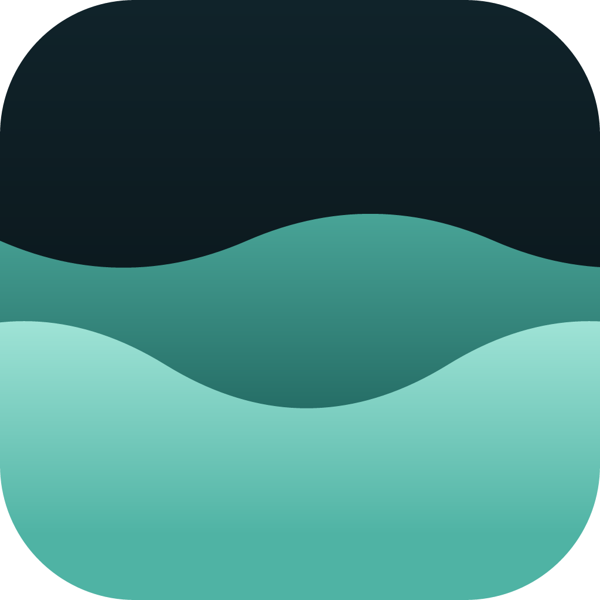

<h1 align="center">
  
</h1>

<h1 align="center">Cove</h1>

<p align="center">Time, held.</p>

<p align="center">
  <a href="https://github.com/thatshubham/no-ai">
    
  </a>
</p>

A small island at the top of your screen for the things that matter about time: what time it is, what needs it, and how you're spending it. Hover for a quick glance, click to open, click again, get back to your work.

Not a Swiss Army knife. Cove does less, on purpose.

## Why Cove

Most notch apps keep adding widgets until they become another dashboard. Cove stays minimal, small, and sheltered.

- **Quiet by default.** It floats above your desktop, stays out of the taskbar, and never steals focus.
- **Glanceable.** Collapsed, it shows just the time. Hover for the date and how many tasks are left, and open it only when you need more.
- **Light and fast.** Built with Tauri and Svelte, and WebView2 usage has been optimized to use less RAM.
- **Smooth.** Opening is spring-animated and anchored to the top of the screen like a real notch.
- **Private.** Your tasks are saved locally on your machine.

## What's inside

- **Clock:** the time and date, always one glance away.
- **Todo:** add tasks, check them off, and see how many are left. _(in progress)_
- **Pomodoro:** focus in sessions. _(in progress)_

## Coming soon

- Global hotkey that drops a task straight into Todo
- Animation when a pomodoro session ends
- Shelf: drop in a file and Cove holds it

## What Cove won't do

No weather. No CPU graphs. No notification feed. No kanban board.
If it isn't about time, it doesn't live in the cove.

---

## Get started

**Requirements**

- [Bun](https://bun.sh/)
- [Rust](https://www.rust-lang.org/tools/install)

**Install dependencies**

```sh
bun i
```

**Run in dev**

```sh
bun tauri dev
```

**Build a release**

```sh
bun tauri build
```

## Built with

[Tauri](https://tauri.app/) · [Svelte](https://svelte.dev/) · TypeScript · Vite · [GSAP](https://gsap.com) · [Tailwind CSS](https://tailwindcss.com/)

## License

[MIT](LICENSE)
